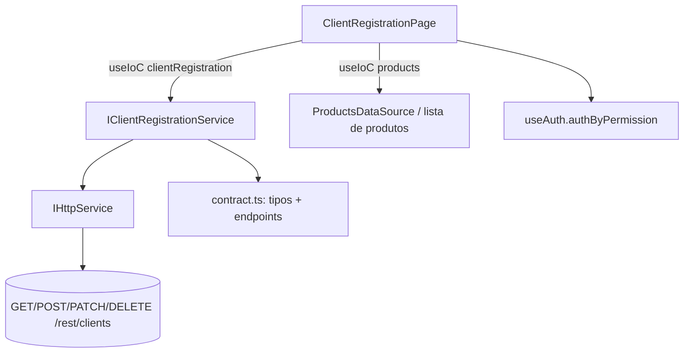

# Design — Clients Integration Alignment

## Visão geral

Evolui a tela **Cadastro de clientes** para cobrir todo o contrato de `docs/frontend-integration/clientes.md`: filiais, vínculo de produtos, contratos por CNPJ (somente leitura), tratamento de erros por status e controle de escrita. A arquitetura existente é mantida: página → service resolvido por IoC (`clientRegistration`) → `IHttpService`.

**Não-objetivos:** back-end; telas de Produtos e Contratos; paginação server-side (a lista segue em `/clients/all`, sem filtros no back).

### Estado atual verificado

- `ClientRegistrationService` (`src/features/client-registration/services`) já mapeia `ClientResponse → ClientRecord` e normaliza CNPJ.
- Tipos e endpoints vivem em `src/features/products/services/contract.ts` (compartilhados com produtos).
- Registro IoC em `src/features/administrador/module.tsx` (`clientRegistration`).
- UI usa `@devs-atem/design-system` (`Table`, `Modal`, `Input`, `StatusTag`, `Skeleton`, `Button`) e `sonner` para toasts. O DS também exporta `Select`, `Autocomplete`, `Checkbox`, `CustomTabs`, `Accordion` e `Pagination`.

## Arquitetura



A lista de produtos para o seletor vem de `GET /rest/products/all` por um método do próprio `Client_Service` (`listProductOptions()`), evitando acoplar a página ao `ProductsDataSource` (que faz N+1; ver spec 2).

## Componentes e interfaces

### Tipos de contrato (`contract.ts`)

```ts
export type ClientContractField =
  | "id" | "internalCode" | "contractNumber" | "ownerId" | "source" | "baseCode"
  | "status" | "effectiveFrom" | "effectiveTo" | "createdBy"
  | "currentRevisionId" | "createdAt" | "updatedAt";

/** Subconjunto de contrato devolvido por `contractFields`. Campos nulos são omitidos. */
export type ClientContractSummary = Partial<Record<ClientContractField, string>>;

export interface ClientResponse extends NestedClientResponse {
  updatedAt: string;
  products?: NestedProductResponse[];
  /** Só presente quando `contractFields` é enviado e algum campo é válido. */
  contracts?: ClientContractSummary[];
}

export const DEFAULT_CLIENT_CONTRACT_FIELDS: ClientContractField[] =
  ["id", "contractNumber", "status", "effectiveFrom", "effectiveTo"];
```

### Endpoints adicionais

`PRODUCTS_ENDPOINTS.clientById(id)` já existe; o detalhe passa `params: { contractFields }` ao `http.get(path, params)`.

### `ClientRecord` e service

```ts
export interface ClientRecord {
  id: string; cnpj: string; branches: string[];
  name: string; bpid: string; active: boolean;
  products?: { id: string; name: string; sapCode: string }[]; // só no detalhe
  contracts?: ClientContractSummary[];                         // só no detalhe c/ contractFields
}

export interface ClientRecordInput {
  cnpj: string; name: string; bpid: string; active?: boolean;
  branches?: string[];     // lista completa (Full_Replace)
  productIds?: string[];   // omitido = não altera
}

export interface IClientRegistrationService {
  list(): Promise<ClientRecord[]>;
  get(id: string, opts?: { withContracts?: boolean }): Promise<ClientRecord>;
  create(input: ClientRecordInput): Promise<ClientRecord>;
  update(id: string, input: ClientRecordInput): Promise<ClientRecord>;
  remove(id: string): Promise<void>;
  listProductOptions(): Promise<{ id: string; name: string; sapCode: string }[]>;
}
```

Regras do service:

- `create`: monta `cnpj: { headquarters: normalize(c), branches: input.branches.map(normalize) }`; **nunca** envia `productIds`.
- `update`: só inclui `productIds` se `input.productIds !== undefined`; `cnpj.branches` sempre completo (assinatura antiga `update(id, input, branches)` é absorvida em `input.branches`; o chamador existente passa `editing.branches` por padrão).
- `get`: `GET clientById(id)` com `contractFields` quando `withContracts` (usa `DEFAULT_CLIENT_CONTRACT_FIELDS`).
- Erros: não captura; `AxiosHttpService` já converte para `AppError` com `status`.

### Mensagens de erro

```ts
function clientErrorMessage(err: unknown, fallback: string): string {
  const status = (err as AppError | null)?.status;
  const msg = err instanceof Error ? err.message : "";
  if (status === 409 && msg) return msg;             // PT, vem da API
  if (status === 400) return /cnpj/i.test(msg) ? "CNPJ inválido." : "Dados inválidos. Revise os campos informados.";
  if (status === 404) return "Cliente não encontrado.";
  return msg || fallback;
}
```

### UI (`ClientRegistrationPage`)

- **Tabela**: colunas Nome, CNPJ, BPID, Filiais (contagem), Situação. Ações: Detalhes, Editar, Remover (as duas últimas condicionadas à Write_Permission).
- **Modal de edição/criação** com `CustomTabs`: *Dados* (CNPJ, nome, BP, ativo), *Filiais* (lista + campo com `maskCnpj` + adicionar/remover) e *Produtos* (checkbox list com busca; só no modo edição, pois produtos não vão na criação).
- **Modal de detalhe** (leitura): dados, filiais, produtos e tabela de contratos com aviso de vínculo por CNPJ.
- **Exclusão**: modal com texto de impacto; se o detalhe prévio mostrou contratos, alerta destacado. A busca de contratos para o alerta é *best effort* (falha não bloqueia a exclusão).
- `canWrite = authByPermission("portal_nave:client_registry:write")`.

## Modelo de dados e mapeamento

| API (`ClientResponse`) | Front (`ClientRecord`) |
|---|---|
| `id` | `id` |
| `name` | `name` |
| `bp` | `bpid` |
| `cnpj.headquarters` | `cnpj` (formatado) |
| `cnpj.branches[]` | `branches[]` (sem máscara; formatados na UI) |
| `isActive` | `active` |
| `products[]` | `products[]` |
| `contracts[]` | `contracts[]` |

## Decisões e riscos

- **Full_Replace** é o maior risco de perda de dados: o service sempre recebe a lista completa e a UI inicializa o estado a partir do detalhe (`get`) antes de permitir salvar produtos/filiais.
- **Abrir edição sem carregar o detalhe** poderia sobrescrever produtos com lista vazia; por isso a aba *Produtos* fica desabilitada até `get()` concluir, e `productIds` só é enviado se a aba foi carregada **e** alterada.
- **Contratos por CNPJ não respeitam escopo de custódia**; a UI deixa isso explícito e aponta para a tela oficial (spec 3).
- **Permissão de escrita** é só UX enquanto o back não aplicar RBAC nas rotas de clientes.
- **Tratamento de CNPJ duplicado "mascarado × não mascarado"** é evitado normalizando sempre antes do envio.

## Estratégia de testes

Vitest com `http` mockado (padrão de `ClientRegistrationService.test.ts`): mapeamento, normalização, Full_Replace de `branches`/`productIds`, omissão de `productIds`, `contractFields`, e `clientErrorMessage` por status.
