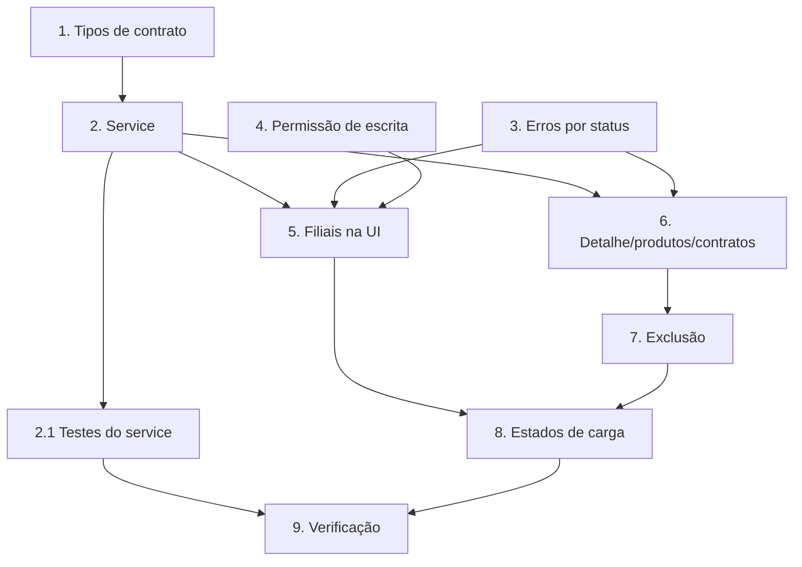

# Plano de Implementação: Clients Integration Alignment

## Visão geral

Atualiza a integração da tela de Cadastro de clientes com `docs/frontend-integration/clientes.md`: filiais, vínculo de produtos (Full_Replace), contratos por CNPJ (somente leitura), erros por status e controle de escrita. É a spec 1 de 3 (seguem `products-integration-alignment` e `contracts-integration`).

## Tarefas

- [x] 1. **Estender o contrato de tipos** — `src/features/products/services/contract.ts`
  - Adicionar `ClientContractField`, `ClientContractSummary`, `contracts?` em `ClientResponse` e `DEFAULT_CLIENT_CONTRACT_FIELDS`.
  - Atualizar `contract.test.ts` cobrindo os novos exports.
  - _Requisitos: 6.4, 10.1_

- [x] 2. **Evoluir o `ClientRegistrationService`** — `src/features/client-registration/services/ClientRegistrationService.ts`
  - Incluir `branches`/`productIds` em `ClientRecordInput`; `products`/`contracts` em `ClientRecord`.
  - Implementar `get(id, { withContracts })` com `contractFields` e `listProductOptions()` (`/rest/products/all`).
  - `create` nunca envia `productIds`; `update` só envia `productIds` quando definido e sempre envia `branches` completos.
  - Atualizar `IClientRegistrationService` e o registro em `administrador/module.tsx` se necessário.
  - _Requisitos: 2.2, 2.4, 3.2, 3.3, 3.4, 5.1, 5.3, 5.4, 6.1, 10.2, 10.3, 10.4_

- [x] 2.1. **Testes do service** — `ClientRegistrationService.test.ts`
  - Cobrir: envio sem máscara, filiais completas/`[]`, omissão e envio de `productIds`, `contractFields`, mapeamento de `contracts` ausente/`[]`, propagação de `AppError`.
  - _Requisitos: 10.5_

- [x] 3. **Mensagens de erro por status** — `src/features/client-registration/clientRules.ts`
  - Extrair `clientErrorMessage` (409 usa `message` da API; 400; 404; fallback) em módulo testável e substituir `errorMessage()` da página.
  - Teste unitário por status.
  - _Requisitos: 8.1, 8.2, 8.3, 8.4, 8.5_

- [ ] 4. **Permissão de escrita** — `ClientRegistrationPage.tsx`, `docs/rbac-portal-nave.md`
  - Usar `authByPermission("portal_nave:client_registry:write")` para exibir Novo/Editar/Remover; modo leitura caso contrário.
  - Documentar a nova chave e registrar a pendência de cadastro no console RBAC.
  - _Requisitos: 9.1, 9.2, 9.3, 9.4_

- [x] 5. **Filiais na UI** — `ClientRegistrationPage.tsx`
  - Coluna "Filiais"; aba *Filiais* com adicionar/remover, `maskCnpj`, validação `isValidCnpj`, bloqueio de duplicata e aviso (não bloqueante) para filial igual à matriz.
  - _Requisitos: 1.1, 2.3, 3.1, 4.1, 4.2, 4.3, 4.4_

- [x] 6. **Detalhe, produtos e contratos** — `ClientRegistrationPage.tsx`
  - Modal de detalhe chamando `get(id, { withContracts: true })`; aba *Produtos* (seletor com busca, desabilitada até o detalhe carregar) enviando lista completa; tabela de contratos somente leitura com estados vazio/indisponível e aviso de vínculo por CNPJ.
  - Link para `/contratos` filtrado pelo cliente quando houver permissão de leitura (rota efetiva definida na spec 3).
  - _Requisitos: 3.4, 5.1, 5.2, 5.5, 5.6, 6.1, 6.2, 6.3, 6.5, 6.6, 6.7_

- [x] 7. **Exclusão com aviso de impacto** — `ClientRegistrationPage.tsx`
  - Texto de impacto (cascata em filiais/vínculos, sem verificação de contratos) e alerta com quantidade de contratos quando o detalhe prévio os retornar (best effort).
  - _Requisitos: 7.1, 7.2, 7.3, 7.4_

- [x] 8. **Estados de carga/erro/vazio** — `ClientRegistrationPage.tsx`
  - Garantir skeleton inicial, `loading` da tabela em recargas, erro com "Tentar novamente" e vazio.
  - _Requisitos: 1.2, 1.3, 1.4, 1.5_

- [ ] 9. **Verificação**
  - Rodar `yarn build` (tsc + vite), `yarn lint` e `yarn test`; smoke test no dev server (criar, editar filiais, vincular produtos, ver contratos, excluir).
  - _Requisitos: todos_

## Grafo de dependências



```json
{
  "waves": [
    { "wave": 1, "tasks": ["1", "3", "4"] },
    { "wave": 2, "tasks": ["2"] },
    { "wave": 3, "tasks": ["2.1", "5", "6"] },
    { "wave": 4, "tasks": ["7"] },
    { "wave": 5, "tasks": ["8"] },
    { "wave": 6, "tasks": ["9"] }
  ]
}
```

## Notas

- Tarefas 5, 6, 7 e 8 editam o mesmo arquivo de página; na prática executar em sequência ou extrair subcomponentes (`BranchesTab`, `ProductsTab`, `ClientContractsTable`) para reduzir conflitos.
- A chave `portal_nave:client_registry:write` depende de cadastro no console RBAC.
- Os tipos continuam em `features/products/services/contract.ts` para não quebrar imports existentes; mover para um módulo compartilhado fica como melhoria futura.

## Status da implementação (atualizado)

**Concluídas:** 1, 2, 2.1, 3, 5, 6, 7, 8. Verificado com `tsc -b`, ESLint e `vitest` (todos passando).

**Parciais / não feitas**
- **4. Permissão de escrita:** **não implementada, por decisão.** O back de clientes não aplica RBAC por rota, então `client_registry:write` só mudaria a UX e exigiria cadastro no console RBAC. Os botões Novo/Editar/Remover continuam visíveis a quem acessa a tela (`client_registry:read`). Reabrir se o RBAC passar a ser exigido.
- **9. Verificação:** parcial. Falta o smoke test no navegador/dev server contra a API real.

**Divergências em relação ao design**
- **3. Mensagens de erro:** a função se chama `errorMessage` (não `clientErrorMessage`) e fica em `src/features/client-registration/clientRules.ts`, junto com `sameSet`, `buildProductIdsPatch` e `errorStatus`. Coberta por `clientRules.test.ts` (409 com e sem `message`, 400 com CNPJ, 400 genérico, 404, `statusCode`, fallback).
- O modal de edição **não usa abas**: Dados, Filiais e Produtos ficam na mesma tela. A seção de produtos só aparece na edição (a API não aceita `productIds` na criação) e só envia `productIds` se o detalhe foi carregado e a seleção mudou (`buildProductIdsPatch`).
- No salvamento, um 404 mantém o formulário aberto; ele só fecha (e recarrega a lista) se `svc.get` confirmar que o cliente não existe mais.
- Respostas antigas da carga de produtos do formulário são descartadas (contador `editRequest`), para que fechar e abrir outro cliente não misture os vínculos.
- `update` exige `currentBranches` (a API substitui todas as filiais; omitir apagaria as existentes).
- O botão "Ver contratos" no detalhe aponta para `/contratos?clientId=<uuid>` (implementado na spec `contracts-integration`) e só aparece com `portal_nave:contracts:read`.
- A tabela consome a rota paginada `GET /rest/clients?page&limit` (`listPage`); `/clients/all` (`list`) fica só para seletores.
- `ClientRegistrationService.test.ts`: o helper `make` recebe um mock parcial tipado (`HttpMock`), com um único cast comentado.
