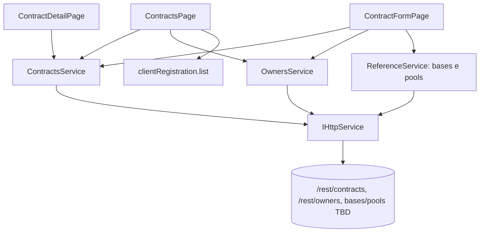

# Design — Contracts Integration

## Visão geral

Troca a tela mock de Contratos por um módulo completo e integrado ao `mw-nave`: listagem com filtros e vínculo por cliente, detalhe com revisões/itens, criação e edição de rascunho, ações de status, nova revisão e gestão dos produtos do depositante. Segue o padrão do projeto: módulo em `src/features/contracts` com `module.tsx` (rotas + menu + `services`), services tipados sobre `IHttpService` resolvidos por IoC, UI com `@devs-atem/design-system`, toasts com `sonner`.

**Não-objetivos:** back-end, CRUD de Owner, Pool/Base (endpoints não mapeados), saldos/movimentações.

### Estado atual verificado

- `src/features/contracts/` tem apenas `module.tsx` (rota `/contratos`, `RouteGuard` com `portal_nave:contracts:read`, menu `FileText` ordem 82) e `pages/ContractsPage.tsx` (formulário mock).
- Outros módulos registram services via `services: (c) => c.add({ key: new Service(c.get("http")) })` e declaram `AppServices` (ver `products/module.tsx`, `administrador/module.tsx`).
- `AxiosHttpService` converte erros em `AppError` com `status`; `IHttpService.get(path, params)` aceita query.
- `useAuth().authByPermission(key)` já é usado para gating de escrita.

## Arquitetura



### Rotas (`module.tsx`)

| Rota | Componente | Permissão |
|---|---|---|
| `/contratos` | `ContractsPage` | `portal_nave:contracts:read` |
| `/contratos/novo` | `ContractFormPage` | `portal_nave:contracts:write` |
| `/contratos/:id` | `ContractDetailPage` | `portal_nave:contracts:read` |
| `/contratos/:id/editar` | `ContractFormPage` | `portal_nave:contracts:write` |

O menu continua com um único item "Contratos".

## Componentes e interfaces

### Tipos (`services/contract.ts`)

```ts
export const REST_PREFIX = "/rest";
export type ContractStatus =
  | "DRAFT" | "PENDING_APPROVAL" | "ACTIVE" | "SUSPENDED"
  | "CLOSING" | "CLOSED" | "CANCELLED" | "EXPIRED";
export type AccountingMeasure = "GOV" | "GSV" | "MASS";
export type StockDeclaration = "ZERO" | "PREEXISTING_STOCK";
export type ContractAction =
  | "submit" | "approve" | "suspend" | "reactivate"
  | "start-closing" | "close" | "cancel";

export interface ContractItemInput {
  productId: string; productCode: string;
  customerProductCode?: string; customerProductDescription?: string;
  poolId: string; accountingMeasure: AccountingMeasure;
  reservedCapacity: string; maximumCapacity: string;       // Decimal_String
  minimumQuota?: string; maximumQuota: string;
  minimumStock?: string; movementLimit?: string;
  movementQuantityTolerancePercent?: string; quotaAlertPercent?: string;
  allowedMovementTypeCodes: string[]; allowedTankCodes: string[];
}
export interface RevisionInput {
  effectiveFrom: string; effectiveUntil?: string | null;
  justification?: string; items: ContractItemInput[];
}
export interface CreateContractRequest {
  internalCode: string; contractNumber: string; ownerId: string;
  source: string; baseCode: string;
  effectiveFrom: string; effectiveTo?: string | null;
  revision: RevisionInput;
}
export type UpdateContractRequest = CreateContractRequest;   // PATCH = Full_Replace
export interface NewRevisionRequest extends RevisionInput { justification: string }
export interface ContractActionRequest {
  justification?: string; stockDeclaration?: StockDeclaration;
}
```

As respostas (`ContractResponse`, `RevisionResponse`, `ItemResponse`, `OwnerResponse`, `OwnerProductResponse`) espelham a seção 3 do guia; campos opcionais ausentes são `undefined` (a API omite `null`).

```ts
export const CONTRACTS_ENDPOINTS = {
  root: `${REST_PREFIX}/contracts`,
  byId: (id: string) => `${REST_PREFIX}/contracts/${encodeURIComponent(id)}`,
  action: (id: string, a: ContractAction) => `${REST_PREFIX}/contracts/${encodeURIComponent(id)}/${a}`,
  revisions: (id: string) => `${REST_PREFIX}/contracts/${encodeURIComponent(id)}/revisions`,
  owners: `${REST_PREFIX}/owners`,
  ownerById: (id: string) => `${REST_PREFIX}/owners/${encodeURIComponent(id)}`,
  ownerProducts: (id: string) => `${REST_PREFIX}/owners/${encodeURIComponent(id)}/products`,
  ownerProduct: (o: string, p: string) => `${REST_PREFIX}/owners/${encodeURIComponent(o)}/products/${encodeURIComponent(p)}`,
} as const;
```

### Services

```ts
export interface ContractListQuery {
  page?: number; limit?: number;                  // limit 1..100
  source?: string; baseCode?: string; ownerId?: string;
  status?: ContractStatus; internalCode?: string; contractNumber?: string;
}
export interface IContractsService {
  list(q: ContractListQuery): Promise<{ rows: ContractResponse[]; total: number }>;
  get(id: string): Promise<ContractResponse>;
  create(b: CreateContractRequest): Promise<ContractResponse>;
  update(id: string, b: UpdateContractRequest): Promise<ContractResponse>;
  act(id: string, a: ContractAction, b?: ContractActionRequest): Promise<ContractResponse>;
  createRevision(id: string, b: NewRevisionRequest): Promise<ContractResponse>;
}
export interface IOwnersService {
  list(q?: { page?: number; limit?: number; status?: "ACTIVE" | "INACTIVE";
             internalCode?: string; cnpj?: string }): Promise<{ rows: OwnerResponse[]; total: number }>;
  get(id: string): Promise<OwnerResponse>;
  listProducts(ownerId: string): Promise<OwnerProductResponse[]>;
  addProduct(ownerId: string, b: { productId: string; customerProductCode?: string;
                                    customerProductDescription?: string }): Promise<OwnerProductResponse>;
  updateProduct(ownerId: string, productId: string, b: { customerProductCode?: string;
                                       customerProductDescription?: string }): Promise<OwnerProductResponse>;
  removeProduct(ownerId: string, productId: string): Promise<void>;
  /** Owners cujo CNPJ (normalizado) ∈ cnpjs. Uma consulta por CNPJ, em paralelo limitado. */
  findByCnpjs(cnpjs: string[]): Promise<OwnerResponse[]>;
}
```

Regras do `ContractsService`:

- `list` **filtra chaves indefinidas/vazias** antes de chamar o `http.get`, evitando parâmetros desconhecidos (400) e clampa `limit` em 1..100.
- `act` aceita qualquer 2xx (o `AxiosHttpService` já rejeita não-2xx); body montado só com as chaves permitidas (`justification`, `stockDeclaration`).
- Nenhum método remove campos nulos de resposta manualmente; os tipos usam `?:` e a UI trata `undefined`.

### Serviço de referência (Base e Pool) — **bloqueado por questão em aberto 1**

```ts
export interface IReferenceService {
  listBases(): Promise<{ source: string; baseCode: string; name?: string }[]>;
  listPools(q: { source: string; baseCode: string; productId?: string; at?: string }):
    Promise<{ id: string; name: string }[]>;
}
```

Enquanto os endpoints não forem confirmados, a implementação inicial é um `StubReferenceService` que lê `source`/`baseCode` de campos de texto livre e `poolId` de input UUID, atrás da mesma interface, para destravar o restante sem retrabalho.

### Helpers puros (`services/contractRules.ts`)

- `isValidDecimalString(s)`: `^(0|[1-9]\d*)(\.\d{1,3})?$`.
- `isValidPercentString(s)`: até 4 casas e `0 ≤ n ≤ 100`.
- `toIsoUtc(date)`: ISO-8601 UTC.
- `validateRevision(contractWindow, revision, existingRevisions?)`: devolve lista de erros por campo (datas, capacidades, cotas, produto único por pool, mínimos de itens/movimentos).
- `allowedActions(status, permissions)`: matriz de ações por status (Requisito 6.1), sem "cancelar" em `ACTIVE`.
- `clientOwnerMatch(cnpjs, ownerCnpj)`: comparação por `normalizeCnpj` (reutiliza `features/products/services/contract.ts`).

### Vínculo Cliente → Contrato (Requisito 2)

```text
selectClient(client):
  cnpjs   = [client.matriz, ...client.branches] (normalizados)
  owners  = OwnersService.findByCnpjs(cnpjs)           // GET /owners?cnpj=
  if owners.empty → estado "sem depositante"
  results = owners.map(o => ContractsService.list({ ...filtros, ownerId: o.id, limit }))
  merge por id; ordenar por updatedAt desc; total = Σ totals
```

Para exibir o cliente em cada linha, a listagem carrega `GET /rest/clients/all` uma vez e monta `Map<normalizedCnpj, clientName>`; o depositante vem de `row.owner` (se existir) ou de `OwnersService.get` em lote com cache em memória por `ownerId`. A paginação do filtro por cliente é feita no front sobre a união (limitação documentada).

### UI

- **ContractsPage**: `PageTitleCard`, barra de filtros (`Select` status, `Input` códigos, `Autocomplete` cliente, base), `Table` com paginação, botão "Novo contrato" (write). Ação de linha: abrir detalhe.
- **ContractDetailPage**: cabeçalho com status (`StatusTag`) e botões de `allowedActions`; `CustomTabs`: *Resumo*, *Revisões* (`Accordion` por revisão com tabela de itens), *Depositante* (dados do Owner e produtos habilitados, com vínculo/edição de rótulos se write).
- **ActionModal**: `Modal` com `Textarea` de justificativa (obrigatória, exceto `submit`) e `Select` de `stockDeclaration` no approve.
- **ContractFormPage** (novo/editar) e **RevisionFormModal**: seções *Dados gerais*, *Vigência*, *Itens* (lista dinâmica; cada item em `Accordion`). Estado local com validação a cada alteração via `validateRevision`; envio só se sem erros.
- **Mensagens de erro** em `contractErrors.ts`: mapa de mensagens da API conhecidas (`Only DRAFT contracts can be edited`, `Invalid contract transition`, `Opening declaration missing...`, `non-zero custody exposure`, `Contract identity already exists`, `Product ... is not linked to the Owner`, `Pool does not allow the product`) para textos em português; demais usam a `message` original quando legível; 403 sempre gera "Você não tem permissão para esta ação".

## Modelo de dados

| API | Front |
|---|---|
| Quantidades (`reservedCapacity`…) | `string` (nunca `number`) |
| Datas | ISO-8601 UTC; `<input type="date">`/DS → `toIsoUtc` |
| `effectiveTo`/`effectiveUntil` `null`/omitido | "Indeterminada" |
| `Revision.approvedAt` ausente | "Rascunho" |
| `status` | enum `ContractStatus` + `StatusTag` (cores: ACTIVE success, DRAFT/PENDING neutro/aviso, SUSPENDED aviso, CLOSED/CANCELLED/EXPIRED neutro) |

## Decisões e riscos

- **Remoção do formulário mock**: os campos antigos não existem na API; mantê-los criaria dados que nunca são persistidos. Decisão registrada na introdução (questão 4).
- **Endpoints de Pool/Base desconhecidos**: isolados atrás de `IReferenceService` para não bloquear o restante; o `StubReferenceService` é temporário.
- **Permissões duas famílias** (`portal_nave:*` no front, `app:custody:*` no back): o front controla UX e o back é a fonte de verdade; 403 é tratado de forma amigável. Chaves `approve` e `status` precisam ser cadastradas no RBAC.
- **Escopo de dados**: lista vazia pode significar "sem acesso". A UI comunica isso e nunca trata como erro.
- **Filtro por cliente** exige N consultas (uma por Owner) e paginação no front; aceitável porque um cliente tem poucos Owners. Alternativa futura: filtro `cnpj` no back.
- **Full_Replace** em PATCH e nova revisão: o formulário é sempre inicializado do detalhe atual e envia todos os itens; um item perdido seria removido.
- **Ações respondem 201**: nunca depender de 200.
- **Risco de estado obsoleto**: após qualquer 400/404/409 de transição, recarregar o detalhe.

## Estratégia de testes

Vitest, com `http` mockado (padrão de `ClientRegistrationService.test.ts`):
- `contractRules`: decimais, percentuais, datas, produto único por pool, matriz de ações.
- `ContractsService`: query estrita (sem chaves indefinidas), clamp de `limit`, `act` com body mínimo, aceitação de 201.
- `OwnersService.findByCnpjs` e `clientOwnerMatch`.
- `contractErrors`: mapeamento por status/mensagem.
- Testes de componente (Testing Library) para `ActionModal` (justificativa obrigatória) e `allowedActions`.
