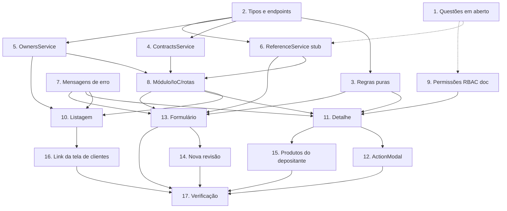

# Plano de Implementação: Contracts Integration

## Visão geral

Substitui a tela mock de Contratos por um módulo integrado ao `mw-nave` (`docs/frontend-integration/contratos.md`): listagem com filtros e vínculo por cliente (via CNPJ do Owner), detalhe com revisões/itens, criação/edição de rascunho, ações de status, nova revisão e produtos do depositante. Spec 3 de 3; reutiliza `normalizeCnpj` e o padrão de erros das specs 1 e 2.

## Tarefas

- [x] 1. **Resolver questões em aberto com o back** (bloqueio parcial)
  - Confirmar: endpoints de Bases e Pools; forma das linhas de `GET /contracts` (inclui `owner`?); mapeamento de permissões `portal_nave:contracts:*` × `app:custody:contract:*`; ausência de dados a migrar do formulário mock.
  - Registrar as respostas na seção "Questões em aberto" de `requirements.md`.
  - _Requisitos: 4.4, 9.4_

- [x] 2. **Tipos e endpoints** — `src/features/contracts/services/contract.ts`
  - Tipos de request/response, enums de status/ações, `CONTRACTS_ENDPOINTS`.
  - _Requisitos: 10.1_

- [x] 3. **Regras puras e testes** — `src/features/contracts/services/contractRules.ts` (+ `.test.ts`)
  - `isValidDecimalString`, `isValidPercentString`, `toIsoUtc`, `validateRevision`, `allowedActions`, `clientOwnerMatch`.
  - _Requisitos: 4.5, 4.6, 4.7, 6.1, 6.2, 7.4, 10.4_

- [x] 4. **`ContractsService` + testes** — `ContractsService.ts` (+ `.test.ts`)
  - `list` (query estrita e clamp de `limit`), `get`, `create`, `update`, `act`, `createRevision`.
  - _Requisitos: 1.3, 1.4, 6.3, 6.5, 10.2, 10.5_

- [x] 5. **`OwnersService` + testes** — `OwnersService.ts` (+ `.test.ts`)
  - `list`, `get`, `listProducts`, `addProduct`, `updateProduct`, `removeProduct`, `findByCnpjs`.
  - _Requisitos: 2.3, 8.1, 8.2, 8.3, 10.5_

- [x] 6. **`IReferenceService` com stub** — `ReferenceService.ts`
  - Interface de bases/pools e `StubReferenceService`; implementação real após a tarefa 1.
  - _Requisitos: 4.1, 4.4_

- [x] 7. **Mensagens de erro** — `contractErrors.ts` (+ teste)
  - Traduzir erros conhecidos; 403 amigável; fallback para `message`.
  - _Requisitos: 4.10, 4.11, 4.12, 5.3, 6.6, 6.7, 6.8, 9.3_

- [x] 8. **Módulo, IoC e rotas** — `src/features/contracts/module.tsx`
  - Registrar `contracts`, `owners`, `reference` em `AppServices`; rotas `/contratos`, `/contratos/novo`, `/contratos/:id`, `/contratos/:id/editar` com `RouteGuard` por permissão.
  - _Requisitos: 9.1, 10.2_

- [x] 9. **Permissões RBAC** — `docs/rbac-portal-nave.md`
  - Documentar `portal_nave:contracts:approve` e `portal_nave:contracts:status` e a pendência de cadastro no console RBAC.
  - _Requisitos: 9.2, 9.4_

- [x] 10. **Listagem com filtros e vínculo por cliente** — `pages/ContractsPage.tsx`
  - Remover o formulário mock; tabela paginada, filtros, filtro por cliente (owners por CNPJ), deep link `?clientId=`, estados vazio/erro/carregando e aviso de escopo.
  - _Requisitos: 1.1–1.8, 2.1–2.6, 9.5, 10.3_

- [x] 11. **Detalhe do contrato** — `pages/ContractDetailPage.tsx`
  - Resumo, revisões/itens, tratamento de nulos e decimais, aba Depositante, botões por `allowedActions` e permissões.
  - _Requisitos: 3.1–3.6, 8.2, 9.2_

- [x] 12. **Modal de ações de status** — `components/ActionModal.tsx`
  - Justificativa obrigatória (exceto `submit`), `stockDeclaration` no approve, erros 400/409/403, recarga do detalhe.
  - Teste de componente da validação.
  - _Requisitos: 6.3–6.10_

- [x] 13. **Formulário de contrato (criar/editar rascunho)** — `pages/ContractFormPage.tsx`
  - Fluxo Owner → produtos do Owner → base → pool → itens; validação com `validateRevision`; envio completo; tratamento de 201/409/403/400/404.
  - _Requisitos: 4.1–4.12, 5.1–5.4_

- [x] 14. **Nova revisão** — `components/RevisionFormModal.tsx`
  - Pré-preenchida com a revisão corrente, justificativa obrigatória, validação de data posterior, erro 409 de exposição.
  - _Requisitos: 7.1–7.6_

- [x] 15. **Produtos do depositante** — `components/OwnerProductsPanel.tsx`
  - Listar, vincular, editar rótulos e desvincular (write), 409 e aviso sobre rótulos não retroagirem.
  - _Requisitos: 8.3, 8.4, 8.5_

- [x] 16. **Integração com a tela de clientes** — `ClientRegistrationPage.tsx` (spec 1)
  - Garantir que o link "Ver contratos" use `/contratos?clientId=<uuid>`.
  - _Requisitos: 2.5_

- [ ] 17. **Verificação**
  - `yarn build`, `yarn lint`, `yarn test`; smoke test fluxo completo: criar → enviar → aprovar → nova revisão → suspender → reativar → encerrar; validar escopo com usuário restrito.
  - _Requisitos: todos_

## Grafo de dependências



```json
{
  "waves": [
    { "wave": 1, "tasks": ["1", "2"] },
    { "wave": 2, "tasks": ["3", "4", "5", "6", "7", "9"] },
    { "wave": 3, "tasks": ["8"] },
    { "wave": 4, "tasks": ["10", "11", "13"] },
    { "wave": 5, "tasks": ["12", "14", "15", "16"] },
    { "wave": 6, "tasks": ["17"] }
  ]
}
```

## Notas

- A tarefa 1 não bloqueia a implementação dos services (2–5, 7–9); só a integração real de bases/pools (tarefa 6 → 13) e o texto final de permissões.
- Os campos do formulário mock (`capacidadeEstatica`, `reservaMinimaEac` etc.) são removidos na tarefa 10; confirmar a ausência de dado a migrar antes.
- A listagem filtrada por cliente pagina no front (união de consultas por `ownerId`).
- Ordem de execução entre specs: `clients-integration-alignment` → `products-integration-alignment` → `contracts-integration`. A tarefa 16 desta spec depende do link criado na tarefa 6 da spec de clientes.

## Status da implementação (atualizado)

**Concluídas:** 1 a 16. Verificado com `tsc`, ESLint, `vite build` e `vitest` (todos passando).

**Parcial**
- **17. Verificação:** falta o smoke test do fluxo completo (criar → enviar → aprovar → nova revisão → suspender → reativar → encerrar) contra a API real e com usuário de escopo restrito. Também não há teste de componente para o `ActionModal` (a regra de justificativa obrigatória não tem teste automatizado).

**Divergências em relação ao design**
- **Tarefa 1:** o back respondeu as questões: formato das respostas, bases/pools/tanques (`contratos-apoio-permissoes.md`), filtro por cliente e permissões. Resta apenas a lista oficial de tipos de movimento.
- **Tarefa 6:** `ReferenceService` é a implementação **real** (`/operational-catalog/bases`, `/operational-catalog/tanks`, `/pools`, `/products/all`), não um stub. Acrescentado `listPoolsByBase` para resolver nomes de pool.
- **Tarefa 14:** a nova revisão **não é um modal**; reutiliza `ContractFormPage` com `mode="revision"` na rota `/contratos/:id/nova-revisao`, junto com o `RevisionEditor` compartilhado.
- **Permissões do front:** `portal_nave:contracts:{read,write,approve,status}` controlam a UX; o back valida `app:custody:contract:*`. Acesso restrito ao `nave_gestor_contratos` e ao admin.
- **Produtos do depositante:** o back devolve `{ rows, total }` com `product: { id, sapCode, name }`; o `id` da linha é o do vínculo. No item, `productId = product.id` e `productCode = product.sapCode`. Tipos e painel ajustados.
- **Filtro por cliente:** o back só filtra por `ownerId`. O front busca **todas as páginas** de cada depositante do cliente (`ContractsService.listAll`), une e só depois pagina, para que total e páginas fiquem corretos (custo: mais chamadas).
- **Nomes de pool e produto no detalhe:** o contrato traz só `poolId`; o front resolve por `GET /pools?source&baseCode` e pelo catálogo de produtos, com fallback para o início do id (403 sem `pool:read`).

**Pendências**
1. Lista oficial de tipos de movimento com quem mantém o supervisório. Até lá: `ENTRADA`/`SAIDA` fixos mais campo para código adicional (código divergente vira `UNAUTHORIZED_MOVEMENT_TYPE`).
2. Back: o gestor precisa de `write/approve/status` em `CUSTODY_ROLE_PERMISSIONS` (hoje só o administrador tem) e o seed precisa ser reaplicado.
3. Back (opcional): filtro `ownerCnpj`/`clientId` em `/contracts` e `poolCode`/`poolName` no item da resposta.
4. Cadastro das chaves `portal_nave:contracts:approve` e `portal_nave:contracts:status` no console RBAC.
