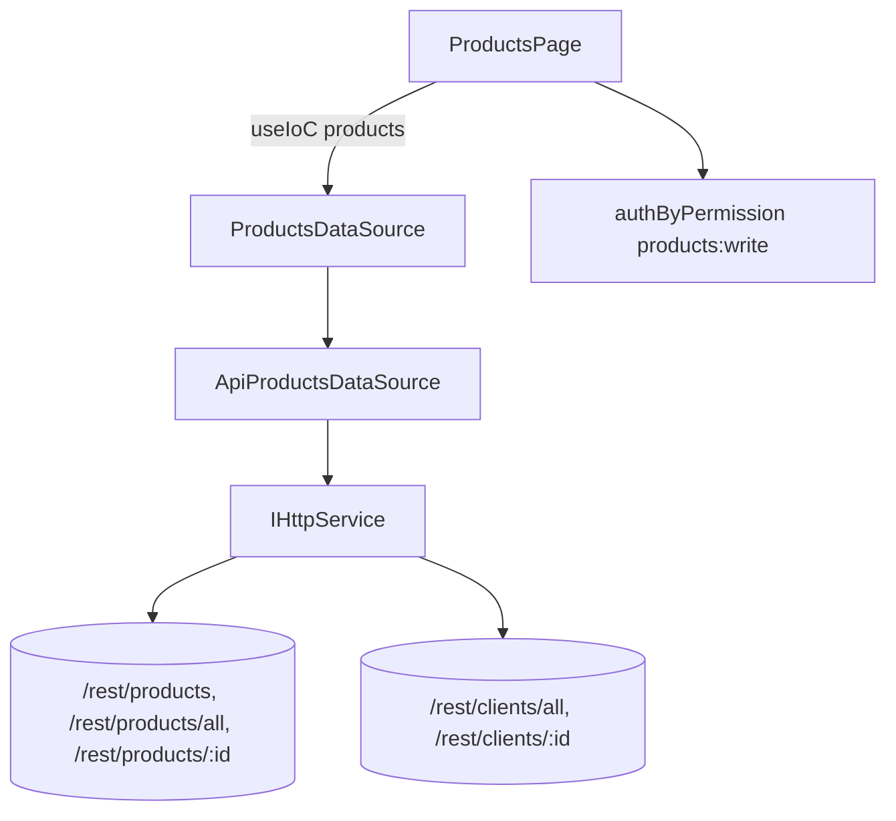

# Design — Products Integration Alignment

## Visão geral

Transforma a tela de Produtos de somente-leitura com campos fictícios em uma tela alinhada a `docs/frontend-integration/produtos.md`: modelo fiel à API, carga eficiente dos vínculos, CRUD de produto, edição de vínculos com clientes (Full_Replace), tratamento do delete em uso e controle de escrita. Mantém o padrão da spec anterior (`products-page-alignment`): página → `ProductsDataSource` (IoC `products`) → `IHttpService`.

**Não-objetivos:** back-end; OwnerProduct/contratos (spec 3); grupo/sigla/status de produto.

### Estado atual verificado

- `ApiProductsDataSource` mantém snapshot (`_products`, `_clients`, `_links`) e mapas bidirecionais UUID ↔ id numérico (`Cliente.id` é `number` no domínio compartilhado).
- `load()` faz N+1 em `/products/:id`.
- `toCatalogProduct` fabrica `abbreviation`, `group`, `active`.
- `ProductsPage` já tem `CustomTabs`, `Select`, `Table`, `Skeleton`, `StatusTag`, painel lateral (`selected`) e CSS `ProductsPage.css`.

## Arquitetura



## Componentes e interfaces

### `CatalogProduct` (reduzido)

```ts
export interface CatalogProduct {
  id: string;
  name: string;
  sapCode: string;
  /** Apenas visual, derivado do id. */
  color: string;
}
```

`abbreviation`, `group` e `active` são removidos do tipo. Os usos em `ProductsPage`, `ProductsPage.css` (tags de grupo `nm-prod__tag--*`) e testes existentes são ajustados (tarefa dedicada). `ProductClientLink` permanece.

### `ProductsDataSource` (estendido)

```ts
export interface ProductsDataSource {
  readonly products: CatalogProduct[];
  readonly clients: Cliente[];
  clientsOfProduct(productId: string): Cliente[];
  productsOfClient(clientId: number): CatalogProduct[];
  clientCountOfProduct(productId: string): number;
  productCountOfClient(clientId: number): number;

  load(): Promise<void>;               // idempotente
  refresh(): Promise<void>;            // descarta snapshot e recarrega

  createProduct(input: { name: string; sapCode: string }): Promise<CatalogProduct>;
  updateProduct(id: string, input: {
    name?: string; sapCode?: string;
    clientUuids?: string[];            // omitido = não altera
  }): Promise<CatalogProduct>;
  deleteProduct(id: string): Promise<void>;

  /** Tradução id numérico substituto → UUID real (uso interno de mutações). */
  clientUuidOf(clientId: number): string | undefined;
}
```

A página converte a seleção de clientes (ids numéricos) em UUIDs por `clientUuidOf` antes de chamar `updateProduct`, mantendo os ids substitutos confinados ao data source.

### Carga pelo lado menor (Requisito 2)

```text
load():
  products = GET /products/all
  clients  = GET /clients/all
  if products.length <= clients.length:
      details = pool(6, products.map(p => GET /products/:id))      // p.clients
      links = ∪ (p.id, c.id)
  else:
      details = pool(6, clients.map(c => GET /clients/:id))        // c.products
      links = ∪ (p.id, c.id)
  falha em qualquer detalhe → rejeita (sem snapshot parcial)
```

`pool(n, tasks)` é um helper pequeno de concorrência limitada (sem nova dependência). Cada lado fornece o conjunto **completo** de vínculos (relação N:N simétrica), portanto basta um deles.

### Escrita

- `createProduct` → `POST PRODUCTS_ENDPOINTS.productsRoot` com `CreateProductRequest`.
- `updateProduct` → `PATCH productById(id)` com apenas as chaves definidas; `clientUuids` vira `clientIds`.
- `deleteProduct` → `DELETE productById(id)`. Erros HTTP propagam como `AppError`; quem decide a mensagem é a página.
- Após qualquer mutação bem-sucedida a página chama `refresh()`.

### Mensagens de erro

```ts
function productErrorMessage(err: unknown, op: "save" | "delete"): string {
  const status = (err as AppError | null)?.status;
  const msg = err instanceof Error ? err.message : "";
  if (op === "delete" && (status === 500 || status === 409))
    return "Produto em uso em contratos e não pode ser excluído.";
  if (status === 409 && msg) return msg;   // PT, vem da API
  if (status === 404) return "Produto não encontrado.";
  if (status === 400) return "Dados inválidos. Revise os campos informados.";
  return msg || "Não foi possível concluir a operação.";
}
```

### UI

- **Tabela**: colunas Produto/Cliente, Código SAP / CNPJ, Código (BP), "Clientes/Produtos" (contagem). Remove coluna Grupo, filtros de grupo/status, `clearFilters` ajustado só para busca.
- **Ações por linha-pai de produto** (com Write_Permission): Editar, Vínculos, Excluir. Linha-pai de cliente: nenhuma ação (cliente é editado na spec 1).
- **Modal de produto** (criar/editar): `name`, `sapCode`; aviso de impacto ao alterar `sapCode` (confirmação em segunda etapa).
- **Modal de vínculos**: lista de clientes com checkbox e busca; envia Full_Replace; texto de ajuda do Requisito 5.7.
- **Exclusão**: modal de confirmação com texto de cascata (clientes + OwnerProduct).

## Modelo de dados e mapeamento

| API | Front |
|---|---|
| `ProductResponse.id` | `CatalogProduct.id` |
| `name` | `name` |
| `sapCode` | `sapCode` |
| (derivado do `id`) | `color` |
| `clients[]` (detalhe) | `ProductClientLink` via UUID → id substituto |
| `ClientResponse.bp` | `Cliente.codigo` |
| `ClientResponse.name` | `Cliente.razao` |
| `cnpj.headquarters` | `Cliente.cnpj` (formatado) |

## Decisões e riscos

- **Remover campos fictícios** reduz confusão mas altera a UI existente (filtros some). Registrado como decisão no Requisito 1.
- **N+1 residual**: mesmo no lado menor ainda há N requisições; mitigado por concorrência limitada. Solução definitiva é o back devolver relações nas listagens (pedido ao back).
- **Aviso de `sapCode` sempre exibido**: o front não sabe se o produto está em contrato; consultar a spec 3 para "produto em uso" fica como melhoria.
- **Delete em uso (500)**: tratado no front; correção para 409 é pedido ao back. A página trata 500 e 409 igualmente.
- **Ids numéricos substitutos** nunca vão para a API: toda escrita passa por `clientUuidOf`.
- **Permissão de escrita** é só UX enquanto o back não aplicar RBAC por rota.

## Estratégia de testes

Vitest com `http` mockado: carga pelo lado menor (ambos os ramos), concorrência ≤ 6, falha em um detalhe, ausência de campos fictícios, `updateProduct` com/sem `clientIds`, conversão id numérico → UUID, delete com 500, `productErrorMessage` por status. Atualizar `ApiProductsDataSource.test.ts` e `contract.test.ts` existentes.
