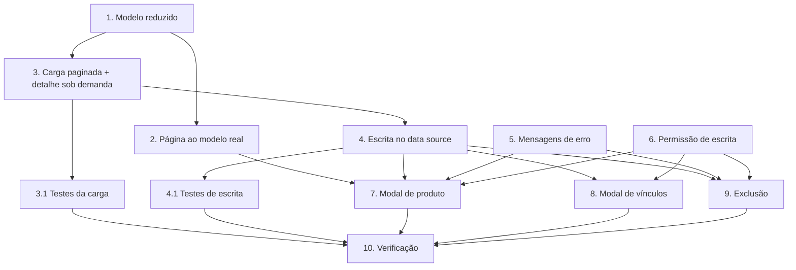

# Plano de Implementação: Products Integration Alignment

## Visão geral

Alinha a tela de Produtos a `docs/frontend-integration/produtos.md`: remove campos fictícios, otimiza a carga dos vínculos, adiciona CRUD de produto, edição de vínculos com clientes (Full_Replace), tratamento do delete em uso e controle de escrita. Spec 2 de 3; depende dos tipos compartilhados da spec `clients-integration-alignment` (tarefa 1 dela).

## Tarefas

- [x] 1. **Reduzir o modelo `CatalogProduct`** — `src/features/products/services/ProductsService.ts`, `ProductsDataSource.ts`
  - Remover `abbreviation`, `group`, `active`; manter `id`, `name`, `sapCode`, `color`.
  - Ajustar `toCatalogProduct` em `ApiProductsDataSource.ts` e os testes existentes.
  - _Requisitos: 1.1, 1.3, 1.5_

- [x] 2. **Ajustar `ProductsPage` ao modelo real** — `src/features/products/pages/ProductsPage.tsx`, `ProductsPage.css`
  - Remover filtro de grupo/status, coluna Grupo e tag Ativo/Inativo; busca por nome/SAP (produto) e nome/BP/CNPJ (cliente); manter visões, expansão, contagens e mensagem de vazio.
  - Limpar estilos `nm-prod__tag--*` não usados.
  - _Requisitos: 1.2, 1.4, 1.6_

- [x] 3. **Carga paginada com detalhe sob demanda** — `ApiProductsDataSource.ts`
  - _Substitui o desenho original (carga pelo lado menor com pool de concorrência 6 e `refresh()` no data source), descartado quando a API passou a oferecer listagem paginada._
  - `loadProductsPage` / `loadClientsPage` chamam só `GET /rest/products` e `GET /rest/clients` com `page`/`limit` (sem `/all` e sem detalhe por item).
  - Vínculos carregados ao abrir o painel lateral: `getProductDetail` (`GET /products/:id`) e `getClientDetail` (`GET /clients/:id`).
  - `/all` só sob demanda nos seletores de vínculo (`listAllClients`, `listAllProducts`).
  - Recarga após mutação feita pela página (`refresh` em `ProductsPage.tsx`), não pelo data source.
  - _Requisitos: 2.1, 2.2, 2.3, 2.4, 2.5_

- [x] 3.1. **Testes da carga** — `ApiProductsDataSource.test.ts`
  - Listagem paginada sem `/all` nem detalhe por id, respeito à página, resposta sem paginação (array puro), detalhe sob demanda (produto e cliente), cliente desconhecido, propagação de erro e reconciliação de ids substitutos.
  - _Requisitos: 9.3_

- [x] 4. **Operações de escrita no data source** — `ProductsDataSource.ts`, `ApiProductsDataSource.ts`
  - `createProduct`, `updateProduct` (com `clientUuids` → `clientIds`, omitindo quando indefinido), `deleteProduct`, `clientUuidOf`.
  - _Requisitos: 3.2, 3.5, 4.2, 5.3, 5.4, 5.5, 6.2, 9.1, 9.2_

- [x] 4.1. **Testes de escrita** — `ApiProductsDataSource.test.ts`
  - Full_Replace com UUIDs reais, omissão de `clientIds`, `clientIds: []`, `DELETE` com 500 propagado.
  - _Requisitos: 9.3_

- [x] 5. **Mensagens de erro** — `src/features/products/pages/productErrors.ts` (+ teste)
  - Implementar `productErrorMessage` por status e operação (delete em uso = 500/409).
  - _Requisitos: 3.4, 4.5, 4.6, 5.6, 6.3, 6.4, 8.3, 8.4, 8.5_

- [ ] 6. **Permissão de escrita** — `ProductsPage.tsx`, `docs/rbac-portal-nave.md` _(não implementada por decisão; ver "Status da implementação")_
  - `authByPermission("portal_nave:products:write")` controla Novo/Editar/Vínculos/Excluir; documentar a chave e a pendência no console RBAC.
  - _Requisitos: 7.1, 7.2, 7.3, 7.4_

- [x] 7. **Modal de produto (criar/editar)** — `ProductsPage.tsx` (ou `ProductFormModal.tsx`)
  - Validação de campos, confirmação de impacto ao alterar `sapCode`, erro 409 no campo, 404 com `refresh()`.
  - _Requisitos: 3.1, 3.3, 3.4, 4.1, 4.3, 4.4, 4.5, 4.6_

- [x] 8. **Modal de vínculos com clientes** — `ProductClientsModal.tsx`
  - Lista com busca e checkbox partindo do snapshot, envio de lista completa em UUIDs, texto de ajuda sobre vínculo cadastral × Owner.
  - _Requisitos: 5.1, 5.2, 5.3, 5.4, 5.5, 5.6, 5.7_

- [x] 9. **Exclusão com tratamento de "em uso"** — `ProductsPage.tsx`
  - Confirmação com texto de cascata; mensagem "Produto em uso em contratos…" em 500/409.
  - _Requisitos: 6.1, 6.2, 6.3, 6.4_

- [ ] 10. **Verificação** _(parcial: falta o smoke test no navegador)_
  - `yarn build`, `yarn lint`, `yarn test`; smoke test: criar, editar nome, alterar `sapCode` (ver aviso), vincular/desvincular clientes, tentar excluir produto em uso.
  - _Requisitos: todos_

## Grafo de dependências



```json
{
  "waves": [
    { "wave": 1, "tasks": ["1", "5", "6"] },
    { "wave": 2, "tasks": ["2", "3"] },
    { "wave": 3, "tasks": ["3.1", "4"] },
    { "wave": 4, "tasks": ["4.1", "7", "8", "9"] },
    { "wave": 5, "tasks": ["10"] }
  ]
}
```

## Notas

- Tarefas 7, 8 e 9 mexem na mesma página; extrair modais em arquivos próprios reduz conflitos.
- Pedidos ao back (fora de escopo): devolver 409 no `DELETE` de produto em uso; incluir relações nas listagens para eliminar o N+1.
- A chave `portal_nave:products:write` depende de cadastro no console RBAC.
- Alterar `sapCode` não atualiza `productCode` de itens de contrato existentes; o aviso é sempre exibido.

## Status da implementação (atualizado)

**Concluídas:** 1, 2, 3, 3.1, 4, 4.1, 5, 7, 8, 9. Verificado com `tsc -b`, ESLint e `vitest` (77 testes passando na branch `feat/products-ui-integracao`; avisos `react-hooks`/`react-refresh` preexistentes).

**Não feitas / parciais**
- **6. Permissão de escrita:** **não implementada, por decisão.** O back de produtos não aplica RBAC por rota; `products:write` só mudaria a UX e dependeria de cadastro no RBAC. Novo/Editar/Clientes/Excluir aparecem para quem acessa a tela. Reabrir se necessário. Cobre o requisito 7, que fica fora deste PR.
- **10. Verificação:** parcial. Falta o smoke test no navegador contra a API real.

**Divergências em relação ao design**
- **Carga (tarefas 3 e 3.1):** a carga pelo lado menor (pool de concorrência, detalhe do lado com menos registros, `refresh()` no data source) foi substituída por listagem paginada + detalhe sob demanda ao abrir o painel. Elimina o N+1 da carga inicial sem precisar do pool; o `refresh` vive na página.
- As ações Editar / Clientes / Excluir ficam no **painel lateral** (drawer) do produto, não em ações de linha da tabela. "Novo produto" está no cabeçalho da página.
- Os diálogos estão em `pages/ProductDialogs.tsx` (`ProductFormDialog`, `ProductClientsDialog`, `DeleteProductDialog`), em vez de `ProductClientsModal.tsx` separado. As mensagens de erro estão em `pages/productErrors.ts` (com teste).
- A coluna da tabela mostra CNPJ (clientes) e "Código SAP / BP"; sigla, grupo e status foram removidos da UI e do modelo `CatalogProduct`.
- Estilos CSS de tag de grupo (`nm-prod__tag--*`) permanecem em `ProductsPage.css`, sem uso: limpeza pendente.
- Alterar `sapCode` sempre pede confirmação extra (o front não sabe se o produto está em contrato).

**Pedidos ao back (fora do escopo):** `DELETE` de produto em uso hoje responde 500 (deveria ser 409); incluir relações nas listagens eliminaria o N+1 residual.
