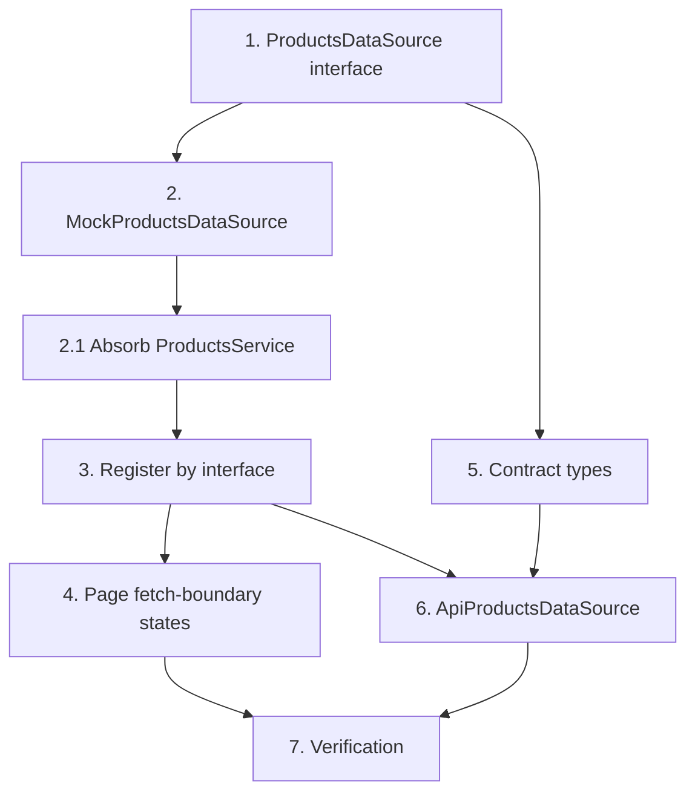

# Implementation Plan: Products Page Alignment

## Overview

This plan aligns the front-end Products page with the data structure the `mw-nave`
back-end is expected to expose for products and their client relationships. The work
introduces a `ProductsDataSource` abstraction resolved from the IoC container so the
current in-memory mock can be swapped for a real API client without changing
`ProductsPage.tsx`. It also encodes, on the front-end, the expected API contract
(`/rest/products` and `/rest/clients` with optional nested relations — products inside
clients and clients inside products). The `mw-nave` products module implementation is
out of scope; only the expected contract is captured and consumed.

## Tasks

- [x] 1. **Define `ProductsDataSource` interface** — `src/features/products/services/ProductsDataSource.ts`
  - Declare the abstraction with the synchronous accessors the page already uses
    (`products`, `clients`, `clientsOfProduct`, `productsOfClient`,
    `clientCountOfProduct`, `productCountOfClient`) plus an idempotent
    `load(): Promise<void>`.
  - Keep `CatalogProduct` and `ProductClientLink` types importable from this module.
  - _Requirements: 9.1, 9.2, 9.4_

- [x] 2. **Implement `MockProductsDataSource`** — `src/features/products/services/MockProductsDataSource.ts`
  - Implement the interface using the current in-memory seeds (`CATALOG`, `LINKS`,
    `CLIENTES`); behavior byte-for-byte identical to today's `ProductsService`.
  - `load()` resolves immediately.
  - Add `MockProductsDataSource.test.ts` covering `clientsOfProduct`,
    `productsOfClient`, both counts, and idempotent `load()`.
  - _Requirements: 9.3_

- [x] 2.1. **Absorb existing `ProductsService` into the mock**
  - Make `ProductsService` the `MockProductsDataSource` (rename or re-export) without
    breaking existing `CatalogProduct` imports.
  - _Requirements: 9.3_

- [x] 3. **Register by interface in the IoC** — `src/features/products/module.tsx`, `src/core/ioc/registry.ts`
  - Type `AppServices["products"]` as the `ProductsDataSource` interface (not the
    concrete class).
  - Register `c.add({ products: new MockProductsDataSource() })` as the default and
    document the one-line swap to `ApiProductsDataSource(c.get("http"))`.
  - _Requirements: 9.1, 9.4_

- [x] 4. **Add fetch-boundary states to `ProductsPage`** — `src/features/products/pages/ProductsPage.tsx`
  - Trigger `svc.load()` and render loading/error/empty states only at the fetch
    boundary; keep all view/search/filter/clear-filters/count/empty logic unchanged.
  - States are inert under the mock (immediate resolve).
  - _Requirements: 1, 2, 3, 4, 5, 6, 7, 8, 9.4_

- [x] 5. **Encode the expected contract types** — `src/features/products/services/contract.ts`
  - Declare TS types for the expected contract (`ProductResponse`, `ClientResponse`
    with optional nested relations) matching the documented API (`/rest/products`,
    `/rest/clients`, UUID ids, optional nested arrays).
  - _Requirements: 10, 11_

- [x] 6. **Implement `ApiProductsDataSource`** — `src/features/products/services/ApiProductsDataSource.ts`
  - Constructor takes `http: IHttpService`. `load()` calls `GET /rest/products`
    (products with nested clients) and `GET /rest/clients` (clients with nested
    products), builds the `products`/`clients`/links snapshot.
  - Map contract→front-end fields (product: name, abbreviation, sapCode, color, group,
    active; client: codigo, razaoSocial→razao, cnpj).
  - Reconcile `Cliente.id` (number) ↔ UUID with a stable bidirectional `Map`, confined
    to the data source. Surface errors via `AppError`.
  - Add `ApiProductsDataSource.test.ts` with a mocked `http`: field mapping, nested
    relation derivation, id reconciliation.
  - _Requirements: 9.2, 9.5, 10.2, 10.3, 12.1, 12.2, 12.3, 12.4, 12.5_

- [x] 7. **Verification**
  - Run `yarn tsc -b` (or `yarn build`), `yarn lint`, `yarn test`, and a dev-server
    smoke test confirming the page renders identically under the mock.
  - _Requirements: 9.4_

## Task Dependency Graph



```json
{
  "waves": [
    { "wave": 1, "tasks": ["1"] },
    { "wave": 2, "tasks": ["2", "5"] },
    { "wave": 3, "tasks": ["2.1"] },
    { "wave": 4, "tasks": ["3"] },
    { "wave": 5, "tasks": ["4", "6"] },
    { "wave": 6, "tasks": ["7"] }
  ]
}
```

## Notes

- Scope is front-end alignment plus the expected contract encoded on the front-end;
  building the `mw-nave` products module is out of scope.
- The HTTP abstraction already exists (`IHttpService` / `AxiosHttpService`, registered
  as `http` in the `iti` container); `ApiProductsDataSource` depends on it via
  `c.get("http")`.
- The mock path must remain the default so the app keeps working with no back-end.
- Product `id` is already a UUID string on the front-end; only the client id needs
  number↔UUID reconciliation.
