# Design — RBAC Module Permissions Binding

## Overview

This design connects the already-implemented RBAC authorization engine of
`frontend-portal-nave` to every Portal da Nave feature module. The engine primitives
exist and are tested; the work here is to bind each module/route to the correct
`portal_nave` permission, keep the admin bypass and menu-group collapsing behavior,
ensure the permission strings match the RBAC IDs exactly, and keep
`docs/rbac-portal-nave.md` aligned with the code.

**Scope boundary:** Registering and assigning permissions in the external RBAC console
is out of scope (back-end/operations). Changing the authorization engine itself
(`RouteGuard`, `useMenuItems`, `generatePermissionMatcher`, the module contract) is also
out of scope. In scope is the per-feature binding (`menu.permission` + `RouteGuard`) and
the documentation alignment.

**Non-goals:** Action-level permissions inside a page (buttons, columns), server-side
permission checks, and any change to how `permissionSet.SYSTEM_MODULES` is populated from
the token.

### Verified current state

Reading the code, the binding is already present across all feature modules:

- `src/core/router/RouteGuard.tsx` — admin bypass first (`if (auth.adminMode) return
  children`), then optional flag check, then permission check against
  `auth.permissionSet.SYSTEM_MODULES` filtered by `rules`; `requireWrite` demands a match
  ending in `:write`. Denied access redirects to `/access-denied`.
- `src/shared/hooks/useMenuItems.ts` — aggregates `module.menu`, sorts by `order`, and
  under non-admin prunes items whose `permission` is not granted (`authByPermission`) or
  whose `flag` is off; a group left with no visible children is dropped.
- `src/shared/utils/index.ts` — `generatePermissionMatcher` builds an exact-match regex,
  expanding only `*` into `[^:]+` (so `foo:bar:*` matches `foo:bar:read`/`:write`).
- `src/core/router/module.contract.ts` — `MenuItem.permission?: string` and the `Module`
  contract are the binding surface.
- Every `src/features/*/module.tsx` already declares the `portal_nave:*` permission
  constants, wraps route elements in `<RouteGuard rules={generatePermissionMatcher(...)}>`,
  and sets `permission` on the menu items (verified in `vehicles`, `balances`, `loads`,
  `dashboard`, `fiscal`, `movements`, `products`, `quality`, `reports`, `administrador`,
  `unloads`).

So this spec is predominantly a verification-and-documentation effort: confirm each
binding, fix any divergence, and align the doc. The doc is already aligned (the Produtos
route is present in the menu→route→permission map), so the only remaining gap is
validation.

## Architecture

The authorization flow has two enforcement points sharing one permission vocabulary:

```mermaid
graph TD
  Token[(Auth token:\npermissionSet.SYSTEM_MODULES)] --> Auth[AuthContext]
  Auth -->|adminMode / authByPermission| Menu[useMenuItems]
  Auth -->|adminMode / permissionSet| Guard[RouteGuard]
  Module[features/*/module.tsx] -->|menu.permission| Menu
  Module -->|RouteGuard + generatePermissionMatcher| Guard
  Menu --> Sidebar[Sidebar: filtered items]
  Guard -->|granted| Page[Route element]
  Guard -->|denied, non-admin| Denied[/access-denied/]
```



Both points read the same `portal_nave:<module>:<action>` vocabulary. The module file is
the single place where a route and its menu entry agree on the same Permission_Id
(Requirement 1.5).

### Enforcement precedence inside RouteGuard

1. **Admin bypass** — `auth.adminMode` short-circuits to render the element
   (Requirements 3.2, 7.2).
2. **Feature flag** — if a `flag` is set and disabled, redirect to `/access-denied`
   (Requirement 7.1); when Flagsmith is disabled in config the flag is treated as enabled
   (Requirement 7.3).
3. **Permission** — the granted `SYSTEM_MODULES` are filtered by the matcher; for a
   Write_Route (`requireWrite`) at least one match must end in `:write`
   (Requirements 2.2–2.4).

### Menu filtering (useMenuItems)

Under non-admin, an item is dropped if its `permission` is not granted or its `flag` is
off; a group is pruned to its visible children and removed entirely if none remain
(Requirement 4). Admin sees everything (Requirement 3.1). The profile entry has no
permission and is always available to authenticated users (Requirement 2.5).

## Components and Interfaces

### Binding surface per module (`src/features/<name>/module.tsx`)

Each module follows one of two shapes already in the codebase:

- **Multi-route with a local `guard` helper** (e.g. `vehicles`, `balances`, `loads`):

  ```tsx
  const PERM_VEHICLES = "portal_nave:vehicles:read";
  const guard = (perm: string, el: ReactElement) => (
    <RouteGuard rules={generatePermissionMatcher(perm)}>{el}</RouteGuard>
  );
  // routes: { path: "/veiculos", element: guard(PERM_VEHICLES, <VeiculosPage />) }
  // menu.children: { label: "Situação de veículos", path: "/veiculos", permission: PERM_VEHICLES }
  ```

- **Single-route inline guard** (e.g. `dashboard`, `fiscal`, `movements`, `reports`,
  `products`, `quality`):

  ```tsx
  const PERM = "portal_nave:movements:read";
  // element: <RouteGuard rules={generatePermissionMatcher(PERM)}>...</RouteGuard>
  ```

The Permission_Id constant is reused for both the route guard and the menu entry, which
is what keeps Requirement 1.5 true by construction.

### Write routes

`/veiculos/novo-agendamento` is the one Write_Route. It binds the `:write` key directly
(`portal_nave:schedules:write`) rather than using `requireWrite`, which satisfies
Requirement 2.4 (the matcher tests the exact `:write` id). If a future route uses a `*`
matcher, it must add `requireWrite` to force the `:write` branch.

### Engine components (unchanged)

`RouteGuard`, `useMenuItems`, `generatePermissionMatcher`, and the `Module`/`MenuItem`
contract are consumed as-is. This spec does not modify them.

## Data Models

### Permission identifier

`portal_nave:<module>:<action>` with `<action> ∈ {read, write}`. Comparison is exact; a
`*` in a matcher expands to `read` and `write` only (`generatePermissionMatcher` →
`replace(/\*/g, "[^:]+")`).

### Authoritative permission set (enforced by the code)

| Permission_Id | Menu → route | Module file |
| --- | --- | --- |
| `portal_nave:dashboard:read` | Início → `/inicio` | `features/dashboard/module.tsx` |
| `portal_nave:products:read` | Produtos → `/products` | `features/products/module.tsx` |
| `portal_nave:balances_tank:read` | Saldos > Saldos por tanque → `/saldos/tanque` | `features/balances/module.tsx` |
| `portal_nave:balances_batch:read` | Saldos > Saldos por lote → `/saldos/lote` | `features/balances/module.tsx` |
| `portal_nave:balances_position:read` | Saldos > Posição dos tanques → `/saldos/posicao` | `features/balances/module.tsx` |
| `portal_nave:balances_online:read` | Saldos > Estoque online → `/saldos/estoque-online` | `features/balances/module.tsx` |
| `portal_nave:vehicles:read` | Veículos > Situação de veículos → `/veiculos` | `features/vehicles/module.tsx` |
| `portal_nave:schedules:read` | Veículos > Agendamentos → `/veiculos/agendamentos` | `features/vehicles/module.tsx` |
| `portal_nave:schedules:write` | Veículos > Novo agendamento → `/veiculos/novo-agendamento` | `features/vehicles/module.tsx` |
| `portal_nave:fiscal_nfe:read` | Fiscal > Consulta de NF-e → `/fiscal/nfe` | `features/fiscal/module.tsx` |
| `portal_nave:unloads_batch:read` | Descargas > Descargas por lote → `/descargas/lote` | `features/unloads/module.tsx` |
| `portal_nave:unloads_period:read` | Descargas > Descargas por período → `/descargas/periodo` | `features/unloads/module.tsx` |
| `portal_nave:loads_report:read` | Cargas > Relatório de cargas → `/cargas/relatorio` | `features/loads/module.tsx` |
| `portal_nave:loads_volume:read` | Cargas > Cargas por volume → `/cargas/volume` | `features/loads/module.tsx` |
| `portal_nave:loads_movement:read` | Cargas > Movimentação de veículos → `/cargas/movimentacao` | `features/loads/module.tsx` |
| `portal_nave:movements:read` | Movimentos → `/movimentos` | `features/movements/module.tsx` |
| `portal_nave:quality_density:read` | Qualidade > Densidades do tanque → `/qualidade/densidades` | `features/quality/module.tsx` |
| `portal_nave:reports:read` | Relatórios → `/relatorios` | `features/reports/module.tsx` |
| `portal_nave:client_registry:read` | Administrador > Cadastro de clientes → `/registrations/clients` | `features/administrador/module.tsx` |
| `portal_nave:admin:read` | Administrador > Administração → `/admin` | `features/administrador/module.tsx` |

Reserved (may be registered in the RBAC but back no screen today):
`portal_nave:quality_density:write`, `portal_nave:admin:write`.

No permission: the profile route (`/perfil`) and all Menu_Groups (Saldos, Veículos,
Fiscal, Descargas, Cargas, Qualidade, Administrador).

### Identifier integrity

Every Permission_Id in the table above was verified against the code via a repository
search for `portal_nave:`. The document `docs/rbac-portal-nave.md` lists exactly this
set (Requirement 6.1) and includes the Produtos row in its menu→route map, so the code
and the doc are aligned (Requirement 6.2).

## Error Handling and Edge Cases

- **Denied access by URL** — a non-admin lacking the permission is redirected by
  `RouteGuard` to `/access-denied` (Requirement 2.2), even when the menu item is hidden.
- **Empty group** — `useMenuItems` removes a group with no visible children
  (Requirement 4.1); the group itself carries no permission (Requirement 4.3).
- **Flag vs permission** — a disabled flag hides/redirects independently of permission;
  admin bypasses both (Requirement 7).
- **String divergence** — any mismatch between a code Permission_Id and the RBAC ID
  silently breaks the match (the matcher is exact), so divergences are fixed in code and
  reflected in the doc (Requirements 5.3, 6.4).
- **Rollout lock-out** — enabling the binding before the RBAC permissions are registered
  and assigned can lock users (and developers) out of bound screens; the binding is
  activated only after registration/assignment is confirmed (Requirement 8).

## Testing Strategy

- **Unit** — `useMenuItems.test.tsx` (existing) covers menu filtering/pruning under
  permission and admin. Keep it green; extend if a new binding shape is introduced.
- **Static verification** — a repository search for `portal_nave:` across
  `src/features/*/module.tsx` must return exactly the authoritative set above; any extra
  or missing id is a defect.
- **Manual validation** (per `docs/task-rbac-vinculo-permissoes.md`):
  1. Non-admin without permission X: the item X is absent from the sidebar and the direct
     URL redirects to `/access-denied`.
  2. Grant permission X and repeat: the item appears and the route opens.
  3. Admin: every menu and route is visible/accessible.
  4. A menu group with no visible child disappears from the sidebar.
- **Gates** — `yarn lint` and `yarn test` pass (includes `useMenuItems.test.tsx`).
