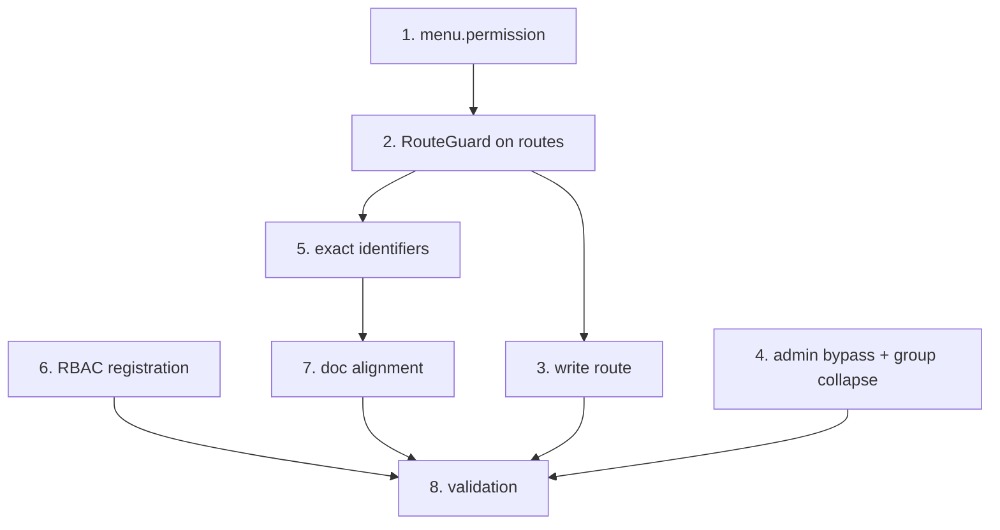

# Implementation Plan: RBAC Module Permissions Binding

## Overview

This plan binds the existing RBAC authorization engine to every Portal da Nave feature
module and keeps the binding documented. The engine (`RouteGuard`, `useMenuItems`,
`generatePermissionMatcher`, the `Module`/`MenuItem` contract) is already implemented and
tested, and every `src/features/*/module.tsx` already declares its `portal_nave`
permission on both the menu item and the route guard. The `portal_nave` permissions were
registered in the RBAC console. What remains is to verify each binding against the
authoritative permission set, fix the one documentation gap (the Produtos row), and run
the manual/automated validation.

Boxes are checked where the code already satisfies the requirement (verified by reading
each module file) and left open where action is still needed.

## Tasks

- [x] 1. **Declare `permission` on every menu item** — `src/features/*/module.tsx`
  - Each module sets `permission` on its `menu` item (or on each `menu.children` entry);
    menu groups carry no permission.
  - Verified present in `dashboard`, `products`, `balances`, `vehicles`, `fiscal`,
    `unloads`, `loads`, `movements`, `quality`, `reports`, `administrador`.
  - _Requirements: 1.1, 1.2, 4.3_

- [x] 2. **Wrap sensitive routes in `RouteGuard`** — `src/features/*/module.tsx`
  - Each route element is wrapped in `<RouteGuard rules={generatePermissionMatcher(id)}>`
    using the same Permission_Id as its menu item.
  - `/perfil` remains unguarded.
  - Verified across all feature modules.
  - _Requirements: 2.1, 2.3, 2.5, 1.5_

- [x] 3. **Bind the write route** — `src/features/vehicles/module.tsx`
  - `/veiculos/novo-agendamento` guards with `portal_nave:schedules:write` (exact `:write`
    key).
  - _Requirements: 2.4_

- [x] 4. **Preserve admin bypass and group collapsing** — engine (no change)
  - `RouteGuard` returns the element when `auth.adminMode`; `useMenuItems` shows all items
    for admin and prunes empty groups for non-admin. No code change required, confirmed by
    reading `RouteGuard.tsx` and `useMenuItems.ts`.
  - _Requirements: 3.1, 3.2, 3.3, 4.1, 4.2, 7.2_

- [x] 5. **Verify exact permission identifiers** — repo search
  - Searched `portal_nave:` across `src/features/*/module.tsx`; the referenced ids match
    the authoritative set in `design.md` character-for-character. The matcher is exact
    (only `*` expands to `read`/`write`).
  - _Requirements: 5.1, 5.2, 5.4_

- [x] 6. **Register permissions in the RBAC console** — external (done by operator)
  - The 20 `portal_nave` permissions were registered under the `portal_nave` product and
    assigned to the test profiles. (Reserved `:write` ids optional.)
  - _Requirements: 8.1_

- [x] 7. **Align `docs/rbac-portal-nave.md` with the code** — `docs/rbac-portal-nave.md`
  - Produtos row present in the menu→route→permission map
    (`Produtos → /products → portal_nave:products:read → features/products/module.tsx`).
  - Permission table lists the 20 enforced ids plus the two reserved ids
    (`portal_nave:quality_density:write`, `portal_nave:admin:write`) marked as reserved.
  - _Requirements: 6.1, 6.2, 6.3, 6.4_

- [ ] 8. **Manual + automated validation**
  - Non-admin without permission X: item X absent from sidebar AND direct URL redirects to
    `/access-denied`.
  - Grant permission X and repeat: item appears and route opens.
  - Admin: all menus/routes visible and accessible.
  - A menu group with no visible child disappears.
  - Run `yarn lint` and `yarn test` (includes `useMenuItems.test.tsx`) — both green.
  - _Requirements: 2.2, 3.1, 4.1, 8.3_

## Task Dependency Graph



```json
{
  "waves": [
    { "wave": 1, "tasks": ["1", "4", "6"] },
    { "wave": 2, "tasks": ["2"] },
    { "wave": 3, "tasks": ["3", "5"] },
    { "wave": 4, "tasks": ["7"] },
    { "wave": 5, "tasks": ["8"] }
  ]
}
```

## Notes

- The engine is already in place and tested; this spec is verification + documentation,
  not an engine change.
- Rollout order matters: the binding is only safe to rely on after the `portal_nave`
  permissions are registered and assigned (task 6, done) — otherwise non-admin users get
  locked out of bound screens.
- The code is the source of truth for permission ids; `docs/rbac-portal-nave.md` follows
  the code (task 7), not the other way around.
- Feature flags (`menu.flag` / `RouteGuard flag`) are independent of RBAC and must not be
  conflated with permissions.
